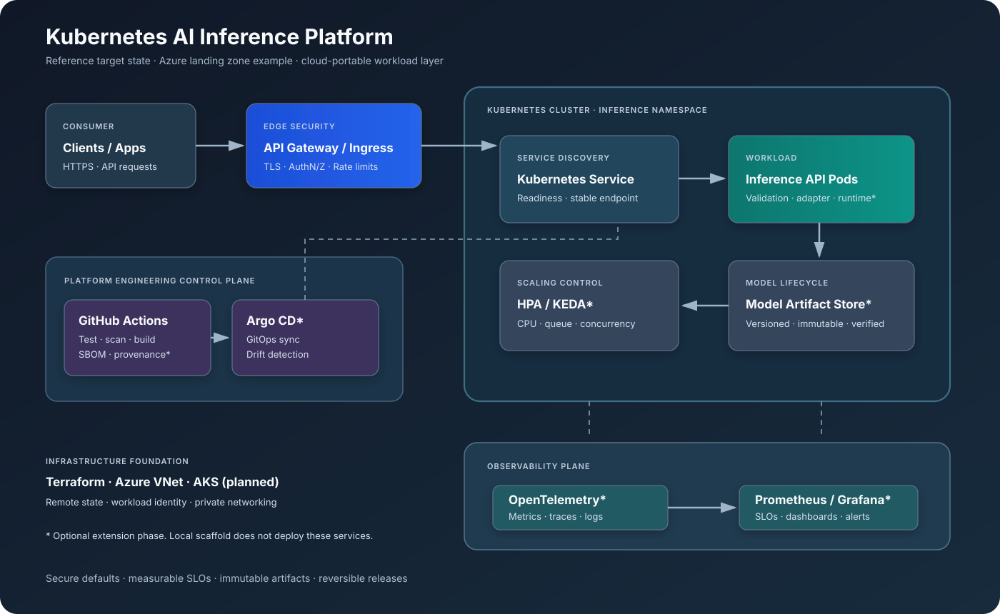

# Kubernetes AI Inference Platform

<p align="center"><strong>A production-minded reference platform for deploying, scaling, securing, and observing AI inference workloads on Kubernetes.</strong></p>

<p align="center">
  
  
  
  
  
  
</p>

> **Status:** This repository provides a runnable deterministic API scaffold, Kubernetes baseline, CI validation, Terraform network foundation example, architecture docs, and operational guidance. Argo CD, KEDA, GPU serving, canary automation, cloud cluster provisioning, and full production telemetry are extension phases—not claimed as live production deployments.

## Executive overview

AI inference platforms must handle more than model containers: workload isolation, request concurrency, accelerator scheduling, model lifecycle, scaling signals, safe releases, supply-chain security, telemetry, cost, and incident response. This project develops those capabilities incrementally, starting with a locally testable baseline and adding cloud integrations only when requirements justify them.

## Reference architecture



### Request lifecycle
1. Client traffic enters through an ingress/API gateway with TLS, authentication, and rate limits.
2. Kubernetes routes requests to healthy inference API pods through a Service.
3. The API validates input and calls an inference adapter. The included adapter is deterministic demo scaffolding; it does not load an ML model.
4. Workload and application telemetry is exported without recording sensitive request payloads.
5. Scaling and rollout policies are introduced after workload signals and SLOs are defined.

## Technology decisions

| Capability | Baseline | Extension / decision gate |
|---|---|---|
| Infrastructure | Terraform | Azure AKS, network, identity, remote state |
| Runtime | Kubernetes | GPU node pools when benchmarks justify them |
| Packaging | Kustomize | Helm for reusable multi-environment packaging |
| Delivery | GitHub Actions CI | Argo CD GitOps reconciliation |
| Autoscaling | HPA-compatible metrics | KEDA with real queue/external metrics |
| Releases | Kubernetes rolling update | Argo Rollouts with metric-based canary |
| Security | Pod hardening, NetworkPolicy, scans | SBOM, signing, admission verification |
| Telemetry | Prometheus request/latency metrics and health endpoints | OpenTelemetry, Prometheus, Grafana |
| Model serving | Adapter interface | vLLM, Triton, or runtime selected by workload |

## Repository structure

```text
.
├── .github/workflows/          # CI quality checks
├── docs/
│   ├── architecture/           # SVG architecture diagram
│   ├── decisions/              # ADRs
│   ├── runbooks/               # Operations procedures
│   ├── scenarios/              # Senior engineering interview scenarios
│   └── implementation-plan.md  # Phased roadmap
├── deploy/app/                 # Kubernetes base and local overlay
├── infra/terraform/            # Terraform foundation example
├── src/inference-api/          # API scaffold and tests
├── security/                   # Threat model
└── scripts/                    # Local validation
```

## Run locally

Prerequisites: Python 3.12; Docker and kubectl for container/Kubernetes steps; kind or minikube for a local cluster.

```bash
# Run API and tests
cd src/inference-api
python -m venv .venv
source .venv/bin/activate
pip install -r requirements.txt
pytest -q
uvicorn app:app --host 127.0.0.1 --port 8000

# Build image from repository root
docker build -t ai-inference-api:dev ./src/inference-api

# With kind: load image and deploy
kind load docker-image ai-inference-api:dev
kubectl apply -k deploy/app/overlays/local
kubectl -n ai-inference rollout status deployment/inference-api
kubectl -n ai-inference port-forward svc/inference-api 8080:80
curl -fsS http://127.0.0.1:8080/healthz
curl -fsS -X POST http://127.0.0.1:8080/v1/infer \
  -H 'Content-Type: application/json' \
  -d '{"model":"demo-model","input":"platform engineering"}'
```

The endpoint returns a deterministic demo response, not a model prediction. The local overlay expects the image to be loaded into the cluster.

## Phased delivery roadmap

| Phase | Deliverable | Exit evidence |
|---|---|---|
| 0 — Architecture | Context, trust boundaries, SLOs, ADRs, threat model | Reviewed design and explicit assumptions |
| 1 — API baseline | Validation, health endpoints, tests, container | CI passes; local smoke test succeeds |
| 2 — Kubernetes | Namespace, hardened deployment, Service, NetworkPolicy | Workload healthy; policy reviewed |
| 3 — IaC | Resource group/VNet/subnet foundation | fmt/validate/plan; state protection designed |
| 4 — GitOps | Argo CD and environment promotion | Git commit reconciles; drift visible |
| 5 — Scaling | HPA baseline, then KEDA with real metrics | Load-test and capacity evidence |
| 6 — Progressive delivery | Canary metrics and rollback policy | Failure experiment aborts bad release |
| 7 — Security/telemetry | SBOM, scans, signing, OTel dashboards | Security gates and actionable signals |
| 8 — Operations | SLOs, runbooks, game days, recovery | Operational exercise completed |

See [implementation plan](docs/implementation-plan.md).

## Reliability and SLO design

Define objectives from measured workload baselines, not assumptions:
- **Availability:** successful eligible requests / eligible requests.
- **Latency:** p50/p95/p99 by model, version, and payload size.
- **Saturation:** queue depth, in-flight requests, CPU throttling, memory pressure, GPU utilization, pending pods.
- **Correctness:** valid response/schema rate and model/runtime error rate.

Alert on sustained user impact and error-budget burn, not CPU utilization alone.

## Security baseline
- Run non-root; drop capabilities; use RuntimeDefault seccomp and read-only root filesystem where compatible.
- Set resource requests/limits and namespace quotas.
- Use default-deny network policy and explicitly allow dependencies.
- Pin production images by immutable digest.
- Scan source, dependencies, IaC, and container images; retain an SBOM.
- Use workload identity and short-lived credentials; never commit secrets.
- Do not log raw prompts, secrets, or customer payloads by default.

See [threat model](security/threat-model.md).

## Advanced platform profiles

- **Real inference:** [vLLM GPU runtime profile](deploy/vllm/README.md) and [ADR-002](docs/decisions/ADR-002-inference-runtime.md). Demo mode remains the default.
- **GitOps:** [Argo CD Application](deploy/gitops/application.yaml).
- **Autoscaling:** [HPA baseline](deploy/app/base/hpa.yaml); [KEDA Prometheus alternative](deploy/autoscaling/keda-prometheus-scaledobject.yaml). Do not apply both to the same Deployment.
- **Progressive delivery:** [Argo Rollouts canary example](deploy/rollouts/canary-rollout.yaml); requires controller, traffic router, and metric-based analysis before production.
- **Observability:** [Prometheus ServiceMonitor](deploy/observability/servicemonitor.yaml) and [OpenTelemetry Collector example](deploy/observability/otel-collector.yaml); both require their respective operators.
- **Security:** [Trivy filesystem workflow](.github/workflows/security.yml).
- **Azure:** Terraform can optionally create AKS with `enable_aks=true`. It defaults to `false` to prevent unexpected spend. Review region, quota, network, identity, node sizing, and cost before enabling.

## Operations

[API unavailable](docs/runbooks/api-unavailable.md) · [High latency](docs/runbooks/high-latency.md) · [Rollback](docs/runbooks/rollback.md)

## Senior engineering scenarios

See [8–12 years interview scenarios](docs/scenarios/senior-engineering-scenarios.md): GPU capacity, queue autoscaling, model rollout, Terraform state recovery, supply-chain compromise, regional outage, retry storms, multi-tenancy, telemetry cost, and burst traffic.

## Contribution and validation

Read [CONTRIBUTING.md](CONTRIBUTING.md). Run `scripts/validate.sh` locally. CI runs API tests, Kubernetes manifest rendering/YAML parsing, and Terraform formatting checks.

Features are marked implemented only when working code, tests, and reproducible validation evidence are committed.
