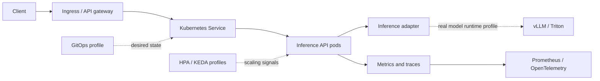

<div align="center">


### Serve · Scale · Secure · Observe AI workloads

[](https://kubernetes.io/)
[](https://developer.hashicorp.com/terraform)
[](https://argo-cd.readthedocs.io/)
[](https://opentelemetry.io/)

**A production-minded reference platform for deploying, scaling, securing and observing AI inference workloads on Kubernetes — starting with a deterministic API baseline and extending toward real model serving.**

[Architecture](#-reference-architecture) · [Run locally](#-run-locally) · [Platform profiles](#-advanced-platform-profiles) · [Operations](#-operations)

</div>

> [!NOTE]
> **Current baseline:** runnable deterministic API scaffold, Kubernetes baseline, CI validation, Terraform network foundation example, architecture docs and operational guidance. The included API adapter returns a deterministic demo response; it does not load an ML model. GPU serving, cloud cluster provisioning, Argo CD, KEDA and canary automation are extension profiles, not claimed live production deployments.

## Executive overview

AI inference platforms must solve more than model packaging. They need request concurrency management, accelerator scheduling, model lifecycle, scaling signals, safe rollout, supply-chain trust, telemetry, cost control and incident response.

This project develops those capabilities incrementally, beginning with a locally testable API and Kubernetes baseline. Advanced components are added as explicit profiles with prerequisites and validation gates.

## Reference architecture

<p align="center">
  
</p>



## Request lifecycle

1. Client traffic enters an approved ingress/API gateway with TLS, authentication and rate limits.
2. Kubernetes routes requests to healthy API pods through a Service.
3. The API validates input and calls an inference adapter.
4. The baseline adapter returns deterministic demo output; it does not load a model.
5. Application and workload telemetry is exported without recording sensitive request payloads.
6. Scaling and rollout policies are enabled only after workload signals and SLOs are defined.

## Technology and decision map

| Capability | Baseline | Extension / decision gate |
|---|---|---|
| Infrastructure | Terraform network foundation | Azure AKS and private networking |
| Runtime | Kubernetes manifests | GPU node pools when benchmarks justify them |
| Packaging | Kustomize | Helm for multi-environment packaging |
| Delivery | GitHub Actions CI | Argo CD GitOps reconciliation |
| Autoscaling | HPA-compatible baseline | KEDA with real queue/external metrics |
| Releases | Kubernetes rolling update | Argo Rollouts with metric-based canary |
| Security | Pod hardening, NetworkPolicy, scans | SBOM, signing and admission verification |
| Telemetry | Health and Prometheus metrics | OpenTelemetry and Grafana |
| Model serving | Deterministic adapter | vLLM, Triton or runtime selected by workload |

## Run locally

Prerequisites: Python 3.12+. Docker and kubectl for container/Kubernetes steps; kind or minikube for local cluster testing.

### API tests and local server

```bash
cd src/inference-api
python -m venv .venv
source .venv/bin/activate
pip install -r requirements.txt
pytest -q
uvicorn app:app --host 127.0.0.1 --port 8000
```

### Build and deploy to kind

From the repository root:

```bash
docker build -t ai-inference-api:dev ./src/inference-api
kind load docker-image ai-inference-api:dev
kubectl apply -k deploy/app/overlays/local
kubectl -n ai-inference rollout status deployment/inference-api
kubectl -n ai-inference port-forward svc/inference-api 8080:80
```

Test the endpoints:

```bash
curl -fsS http://127.0.0.1:8080/healthz
curl -fsS -X POST http://127.0.0.1:8080/v1/infer \
  -H 'Content-Type: application/json' \
  -d '{"model":"demo-model","input":"platform engineering"}'
```

The response is deterministic demo output, not an ML model prediction. The local overlay expects the image to be loaded into the cluster.

## Advanced platform profiles

These profiles are optional and have their own prerequisites. Do not apply every controller/profile simultaneously.

- **Real model runtime:** [vLLM GPU profile](deploy/vllm/README.md) and [ADR-002](docs/decisions/ADR-002-inference-runtime.md). Requires compatible GPU nodes, drivers, model artifacts and capacity planning.
- **GitOps:** [Argo CD Application](deploy/gitops/application.yaml). Requires Argo CD installed and repository access configured.
- **Autoscaling:** [HPA baseline](deploy/app/base/hpa.yaml); [KEDA Prometheus alternative](deploy/autoscaling/keda-prometheus-scaledobject.yaml). Do not apply both to the same Deployment without an explicit scaling ownership design.
- **Progressive delivery:** [Argo Rollouts canary](deploy/rollouts/canary-rollout.yaml). Requires controller, traffic router and metric analysis before production.
- **Observability:** [ServiceMonitor](deploy/observability/servicemonitor.yaml) and [OpenTelemetry Collector example](deploy/observability/otel-collector.yaml). Require the corresponding operators/components.
- **Security:** [Trivy filesystem workflow](.github/workflows/security.yml).
- **Azure:** Terraform can optionally create AKS with `enable_aks=true`; the default is `false` to prevent unexpected spend. Review quota, network, identity, node sizing and cost before enabling.

## SLO and capacity model

Define objectives from measured workload baselines:

| Signal | Example measurement |
|---|---|
| Availability | Successful eligible requests / eligible requests |
| Latency | p50, p95 and p99 by model, version and payload size |
| Saturation | Queue depth, in-flight requests, CPU throttling, memory pressure, GPU utilization and pending pods |
| Correctness | Valid response/schema rate and model/runtime error rate |
| Cost efficiency | Cost per 1,000 requests or per successful inference |

Alert on sustained user impact and error-budget burn, not CPU utilization alone. Do not publish an SLO target until the service boundary, measurement window and workload baseline are defined.

## Security baseline

- Run non-root; drop capabilities; use RuntimeDefault seccomp and read-only root filesystem where compatible.
- Set requests, limits and namespace quotas.
- Use default-deny network policy with explicit dependency allowances.
- Pin production images by immutable digest.
- Scan source, dependencies, IaC and images; retain an SBOM.
- Use workload identity and short-lived credentials.
- Avoid logging raw prompts, secrets or customer payloads by default.

See [threat model](security/threat-model.md).

## Operations

- [API unavailable](docs/runbooks/api-unavailable.md)
- [High latency](docs/runbooks/high-latency.md)
- [Rollback](docs/runbooks/rollback.md)
- [Implementation plan](docs/implementation-plan.md)
- [Architecture decisions](docs/decisions/)

## Senior engineering scenarios

[Open the senior engineering scenario bank](docs/scenarios/senior-engineering-scenarios.md) for GPU capacity, queue autoscaling, model rollout, Terraform state recovery, supply-chain compromise, regional outage, retry storms, multi-tenancy and telemetry cost.

## Contribution and validation

Read [CONTRIBUTING.md](CONTRIBUTING.md). Run `scripts/validate.sh` locally. CI checks API tests, Kubernetes manifest rendering/YAML parsing and Terraform formatting.

Features are marked implemented only when working code, tests and reproducible validation evidence are committed.

## Maintainer

**MD Amirul Haque** · [GitHub](https://github.com/haqueamir70-coder) · [LinkedIn](https://www.linkedin.com/in/md-amirul-haque/)

<sub>Build the serving path first. Scale from evidence. Secure every transition.</sub>
