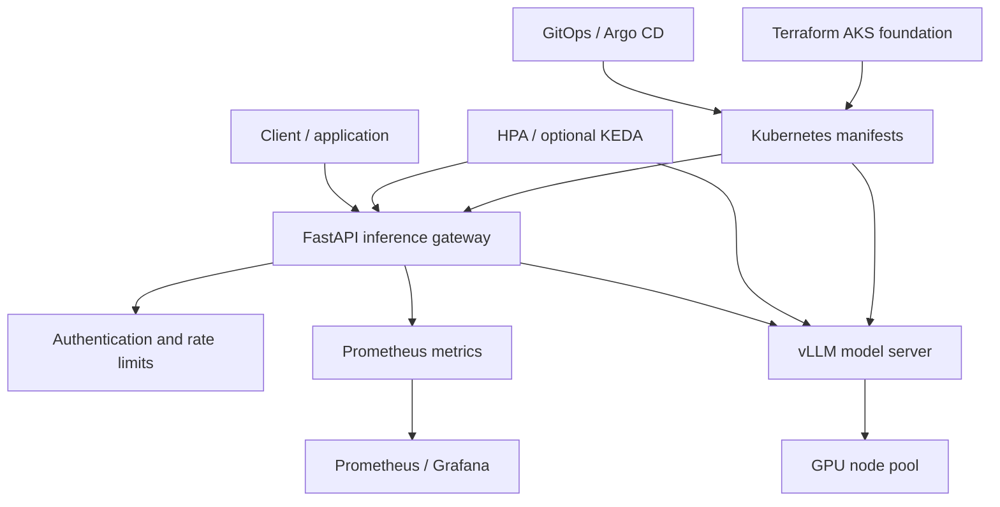

# Kubernetes AI inference platform — Architecture & Interview Guide

Reference architecture for an inference API, vLLM backend, GPU-aware scheduling, autoscaling, observability and GitOps. AKS/GPU/operator deployment is optional and must not be claimed without live evidence.

## Architecture diagram

## Interview questions

1. 1. How does a Kubernetes-hosted LLM inference request flow through the platform?
2. 2. What is vLLM and how does continuous batching improve throughput?
3. 3. How do GPU node pools and device plugins expose accelerators to pods?
4. 4. How do you size GPU memory for model weights and KV cache?
5. 5. What is the difference between HPA and KEDA?
6. 6. Which metrics indicate inference latency, throughput and saturation?
7. 7. How do you protect an inference API from abuse and resource exhaustion?
8. 8. How do rolling updates affect model availability and cold-start time?
9. 9. How do you manage model artifacts, image provenance and secrets?
10. 10. What must be tested in a real AKS/GPU cluster before claiming production readiness?

## Interview preparation note
For every answer, explain the architecture, trust boundary, failure mode, telemetry, cost implication and validation evidence. Distinguish implemented, CI-validated, cloud-deployed and planned capabilities.
