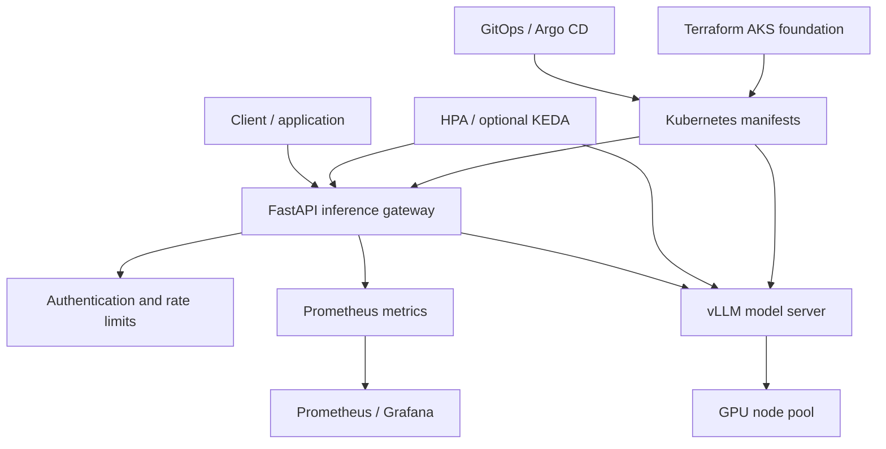

# Kubernetes AI inference platform — Architecture & Interview Guide

Reference architecture for an inference API, vLLM backend, GPU-aware scheduling, autoscaling, observability and GitOps. AKS/GPU/operator deployment is optional and must not be claimed without live evidence.

## Architecture diagram

## Interview questions

1. 1. How does a Kubernetes-hosted LLM inference request flow through the platform?
2. 2. What is vLLM and how does continuous batching improve throughput?
3. 3. How do GPU node pools and device plugins expose accelerators to pods?
4. 4. How do you size GPU memory for model weights and KV cache?
5. 5. What is the difference between HPA and KEDA?
6. 6. Which metrics indicate inference latency, throughput and saturation?
7. 7. How do you protect an inference API from abuse and resource exhaustion?
8. 8. How do rolling updates affect model availability and cold-start time?
9. 9. How do you manage model artifacts, image provenance and secrets?
10. 10. What must be tested in a real AKS/GPU cluster before claiming production readiness?

## Interview preparation note
For every answer, explain the architecture, trust boundary, failure mode, telemetry, cost implication and validation evidence. Distinguish implemented, CI-validated, cloud-deployed and planned capabilities.

## Interview questions — suggested answers

### 1. Answer

The client calls the API gateway, which authenticates/rate-limits, validates payloads and forwards inference requests to vLLM; responses and telemetry flow back through the API.

### 2. Answer

vLLM is an inference serving engine that uses techniques such as PagedAttention and continuous batching to improve GPU memory use and throughput for concurrent requests.

### 3. Answer

GPU node pools provide accelerator-capable VMs; device plugins advertise GPU resources to Kubernetes so pods can request resources such as nvidia.com/gpu.

### 4. Answer

Estimate memory for model weights, KV cache, activations and runtime overhead. Precision, context length, concurrency and batching all affect required VRAM.

### 5. Answer

HPA scales based on resource/custom metrics; KEDA uses event/queue-driven scalers and can scale workloads based on external metrics, including scale-to-zero patterns where supported.

### 6. Answer

Track time-to-first-token, tokens/sec, request throughput, queue depth, p50/p95/p99 latency, GPU utilization/memory, OOMs and model load time.

### 7. Answer

Authenticate clients, enforce quotas/rate limits, validate request size, isolate tenants, limit concurrency and protect model endpoints from direct public access.

### 8. Answer

Model rollout can incur large image/model pulls and GPU warm-up. Use readiness gates, capacity-aware rollout strategy, preloaded artifacts and controlled canary traffic.

### 9. Answer

Pin model and container digests, generate SBOM/provenance, retrieve secrets via workload identity and store model artifacts in controlled registries/object storage.

### 10. Answer

Test scheduling, GPU drivers/device plugin, memory fit, model load, throughput/latency under load, autoscaling, failure recovery, security and cost on a real cluster before production claims.